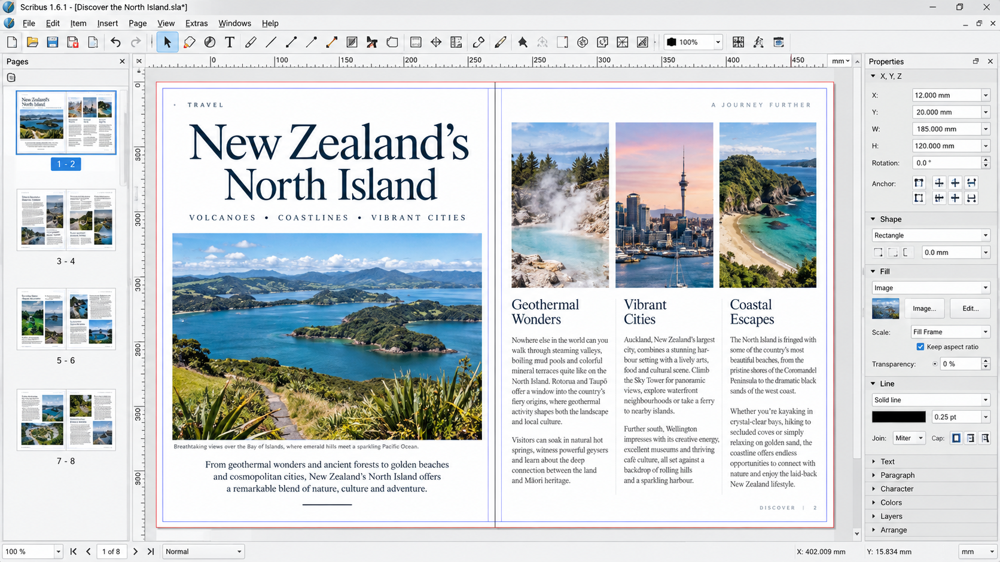
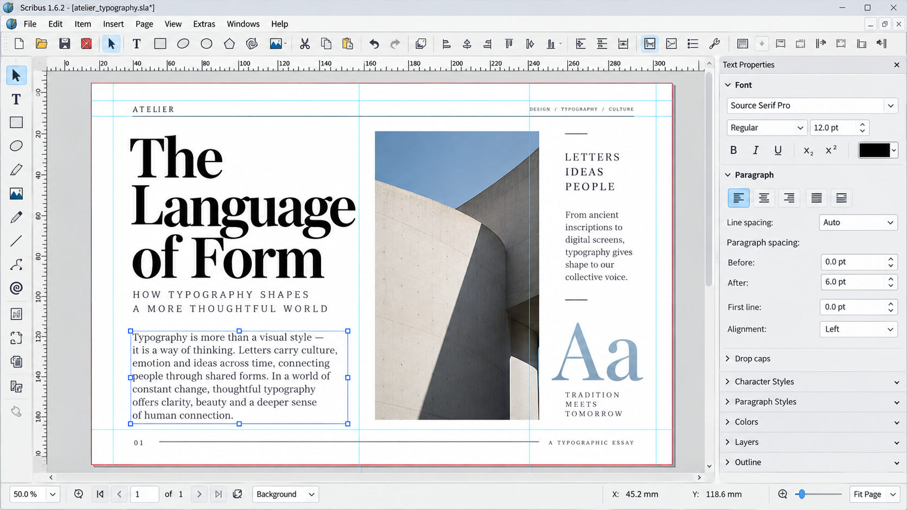
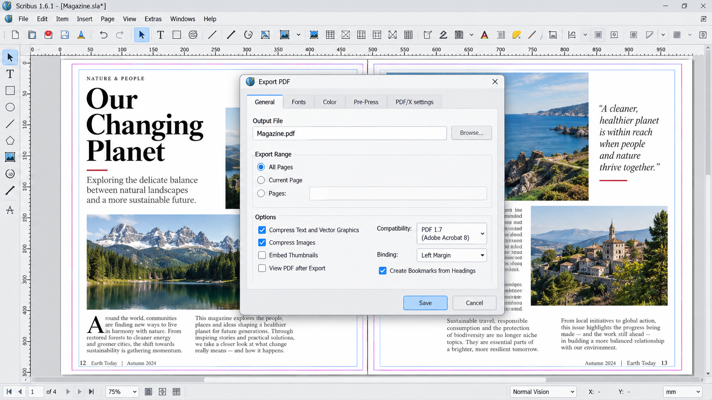

# Scribus Desktop Publishing - Open Source Page Layout And Print Production

Scribus Open Source maintains Scribus Desktop Publishing, a free desktop publishing application for precise page design, professional typography, color-managed artwork, and press-ready PDF production. The project supports books, magazines, posters, brochures, business cards, and other print-focused documents.

[](https://scribus-open-source.github.io/scribus-desktop-publishing/scribus)

## Status

Scribus Desktop Publishing uses a frame-based workflow for arranging text, images, tables, and graphical objects. This curated Scribus Open Source repository preserves the central C++ architecture for the document model, canvas, page items, text layout, color processing, printing, PDF generation, scripting, preferences, and undo handling.

The retained source represents the core structure of Scribus software. Build requirements and known limitations should be checked in [BUILDING](BUILDING) and [CHANGELOG.md](CHANGELOG.md) before using this repository as a complete production distribution.

### What is the Scribus app?

The Scribus app is free, open-source desktop publishing software for designing structured page layouts. Unlike a conventional word processor, Scribus Desktop Publishing places content in independent text, image, table, and shape frames that can be positioned and styled precisely.

Scribus Open Source includes controls for typography, pages, layers, images, CMYK colors, print preview, and PDF production. The underlying document workflow is represented by [src/scribusdoc.cpp](src/scribusdoc.cpp), while page objects are implemented through files such as [src/pageitem.cpp](src/pageitem.cpp), [src/pageitem_textframe.cpp](src/pageitem_textframe.cpp), and [src/pageitem_imageframe.cpp](src/pageitem_imageframe.cpp).

## Overview

- Scribus Desktop Publishing provides precise page and frame placement.
- Scribus software supports text, image, and table page items.
- Scribus color management covers document colors and color transformations.
- Scribus PDF export produces documents intended for review or printing.
- Scribus Python API support enables scripted publishing workflows.
- Scribus Open Source targets desktop environments including Windows and Linux.
- Scribus commercial printing workflows include preview, print settings, and press-oriented output.



### Publishing Vocabulary

scribus software, scribus desktop publishing, scribus open source, scribus pdf export, scribus color management, desktop-publishing, page-layout, print-design, prepress, typesetting, pdf, cmyk, open-source

## New And Noteworthy

Scribus Desktop Publishing combines a native desktop interface with modular document, rendering, and output systems. The selected Scribus Open Source files expose separate components for the application shell, canvas interaction, text shaping, page objects, color processing, PDF writing, printing, plugins, and scripting.

The application architecture also supports complex text workflows. Text frames, story content, text shaping, fonts, and layout are separated into focused components so that document editing and final rendering can share consistent structures.

## Features

### Frame-Based Page Layout

The canvas and canvas modes handle document navigation, object creation, normal interaction, and editing. Their implementations are available in [src/canvas.cpp](src/canvas.cpp), [src/canvasmode.cpp](src/canvasmode.cpp), [src/canvasmode_create.cpp](src/canvasmode_create.cpp), and [src/canvasmode_edit.cpp](src/canvasmode_edit.cpp).

Page items provide specialized behavior for text, images, and tables. This structure supports Scribus book layout, Scribus magazine layout, brochures, posters, and other designs that require exact frame placement.

### Text And Typography

Scribus Desktop Publishing separates stored story content from shaping and page layout. The relevant components include [src/storytext.cpp](src/storytext.cpp), [src/textshaper.cpp](src/textshaper.cpp), [src/textlayout.cpp](src/textlayout.cpp), and [src/scfonts.cpp](src/scfonts.cpp).

This design supports long-form documents, styled text, font selection, and multilingual typesetting. Style management is handled in [src/stylemanager.cpp](src/stylemanager.cpp), allowing reusable formatting decisions across a publication.

### Images, Layers, And Pages

Image processing is represented by [src/scimage.cpp](src/scimage.cpp), while layers and pages are managed by [src/sclayer.cpp](src/sclayer.cpp) and [src/scpage.cpp](src/scpage.cpp). Together, these systems let Scribus software organize complex documents without flattening every element into a single surface.

### Color And Print Production

Scribus CMYK printing and Scribus color management are central parts of professional print preparation. Document colors and transformations are represented by [src/sccolor.cpp](src/sccolor.cpp) and [src/sccolorengine.cpp](src/sccolorengine.cpp).

Scribus commercial printing workflows also include print configuration and preview through [src/printdialog.cpp](src/printdialog.cpp) and [src/printpreview.cpp](src/printpreview.cpp). Users should still confirm bleed, image resolution, fonts, color profiles, and printer requirements before approving final output.

### PDF Output

Scribus PDF export is implemented through dedicated PDF components, including [src/pdfwriter.cpp](src/pdfwriter.cpp) and [src/pdflib.cpp](src/pdflib.cpp). These components form the basis of a Scribus print ready PDF workflow.

> Scribus Desktop Publishing is designed to turn carefully arranged pages into reliable output while preserving control over typography, images, color, and print settings.

### Can Scribus open InDesign?

Scribus Desktop Publishing should not be treated as a native editor for proprietary INDD documents. Direct INDD compatibility is not represented by the retained file-loading components, and complex layouts cannot be assumed to transfer without changes.

For migration, obtain an exchange format supported by the installed Scribus version or request a PDF and the original linked assets from the document author. Fonts, master pages, effects, text flow, colors, and image links should be checked after import. The available loading architecture is represented by [src/fileloader.cpp](src/fileloader.cpp) and [src/loadsaveplugin.cpp](src/loadsaveplugin.cpp), but this repository does not promise lossless conversion from another application's native format.

## Python Bindings

Scribus Python API functionality allows repetitive document operations to be automated. The scripting subsystem is represented by [src/scripter.cpp](src/scripter.cpp) and [src/scriptercore.cpp](src/scriptercore.cpp).

Scripts can support repeatable publication tasks, document setup, object manipulation, and export workflows when the required commands are available in the installed build. API behavior should be verified against the matching Scribus documentation because scripting interfaces may differ between releases.

## Tested Compatible Environments

### Windows

Scribus for Windows provides a native desktop publishing workflow for page layout, typography, images, color preparation, and PDF output. Platform-specific dependencies and compiler requirements are documented in [BUILDING](BUILDING).

#### What is the best free desktop publishing software for Windows?

There is no single best choice for every Windows publishing workflow. Scribus Desktop Publishing is a strong free option when the priority is precise page layout, open-source development, CMYK-oriented preparation, reusable styles, and press-ready PDF output rather than ordinary word processing.

Scribus Open Source is particularly suitable for books, magazines, flyers, brochures, posters, and business cards. A user evaluating Scribus for Windows should test font availability, printer profiles, imported artwork, and final PDF requirements with a representative document before adopting it for production.

### Linux

Scribus Linux builds use the same core document, layout, color, and output architecture. Exact packages and build commands depend on the distribution and the Qt development environment described in [BUILDING](BUILDING).



## Build

Scribus Desktop Publishing uses CMake and Qt-oriented project metadata. The root build definitions are available in [CMakeLists.txt](CMakeLists.txt), and the Qt project definition is available in [Scribus.pro](Scribus.pro).

```sh
cmake -S . -B build
cmake --build build
```

This repository contains a curated source selection rather than every upstream component. A successful full application build may require additional source files, generated files, libraries, and platform dependencies. Follow [BUILDING](BUILDING) as the authoritative starting point.

## Getting Started / Example

A typical Scribus Desktop Publishing workflow is:

1. Create a document with the required page size, margins, and bleed.
2. Add text, image, and table frames to the page.
3. Organize reusable formatting through paragraph, character, and object styles.
4. Place images at a resolution appropriate for the final output.
5. Configure document colors and the required color profiles.
6. Review layers, page order, text overflow, and linked assets.
7. Use print preview to inspect separations and output behavior.
8. Create a Scribus print ready PDF and validate it against the printer's specification.

Scribus examples and Scribus templates can accelerate recurring layouts, but each template should be checked for page dimensions, fonts, linked images, color settings, and export configuration.

## Documentation & Examples

The repository resources are organized as follows:

| Resource | File |
|:--|:--|
| Build instructions | [BUILDING](BUILDING) |
| Change history | [CHANGELOG.md](CHANGELOG.md) |
| Contribution guidance | [CONTRIBUTING.md](CONTRIBUTING.md) |
| Security policy | [SECURITY.md](SECURITY.md) |
| Authors | [AUTHORS](AUTHORS) |
| License terms | [COPYING](COPYING) |

### Can you provide a user guide for Scribus?

A practical Scribus user guide begins with the frame model. Create the document, configure page dimensions, and place text or images in dedicated frames instead of typing directly onto the page. Use the properties interface represented by [src/propertiespalette.cpp](src/propertiespalette.cpp) to adjust position, size, appearance, and content settings.

For text-heavy work, define styles before filling the complete document. Inspect every text frame for overflow, confirm font availability, and review line breaks after changing page geometry. For image-heavy work, retain the original linked assets and check effective resolution at the placed size.

For print work, configure Scribus color management before final export, verify CMYK and spot-color expectations with the printer, and inspect the document using print preview. Complete the Scribus PDF export only after checking bleed, page boxes, embedded fonts, image quality, and output profile settings.

For continued learning, use the project files as focused Scribus documentation. Canvas behavior is in [src/canvas.cpp](src/canvas.cpp), document state is in [src/scribusdoc.cpp](src/scribusdoc.cpp), PDF output is in [src/pdfwriter.cpp](src/pdfwriter.cpp), and scripting is in [src/scripter.cpp](src/scripter.cpp).

## Testing

Changes to Scribus Desktop Publishing should be tested at the component and document levels. Relevant checks include opening and saving documents, creating and editing frames, shaping text, loading images, managing styles, changing colors, previewing print output, creating PDFs, and exercising undo and redo.

The undo infrastructure is represented by [src/undomanager.cpp](src/undomanager.cpp) and [src/undostack.cpp](src/undostack.cpp). Output changes should be compared visually and validated with representative Scribus examples, including multi-page documents and color-managed print files.



## Contributing

Scribus Open Source welcomes focused improvements to Scribus Desktop Publishing. Read [CONTRIBUTING.md](CONTRIBUTING.md), follow the formatting rules in [.editorconfig](.editorconfig), and keep changes compatible with the repository configuration.

Contributions should include a clear explanation, relevant tests, and evidence that document editing and output remain stable. Security-sensitive findings should follow [SECURITY.md](SECURITY.md) instead of being disclosed in a public change request.

## Community & Support

Useful reports describe the Scribus version, operating system, document workflow, expected result, actual result, and reproducible steps. Minimal Scribus examples are preferable to large confidential production files.

When reporting PDF, printing, font, or color problems, include the relevant export settings and whether the problem appears in preview, the generated PDF, or the physical print. Remove private content before sharing a document.

## Design Principles

### Precision Through Frames

Scribus Desktop Publishing treats text, images, tables, and shapes as positioned page objects. This model gives users explicit control over geometry and relationships between elements.

### Power Through Specialized Components

Scribus Open Source separates document state, rendering, text shaping, color handling, output, scripting, plugins, and interface behavior. This keeps individual publishing responsibilities understandable and maintainable.

### Reliability Through Review

Professional output requires more than visually correct pages. Scribus commercial printing workflows should include font checks, image checks, color review, print preview, PDF validation, and confirmation against the printer's specification.

## License

Scribus Desktop Publishing is distributed under the terms recorded in [COPYING](COPYING). Copyright and contributor information is available in [AUTHORS](AUTHORS).
